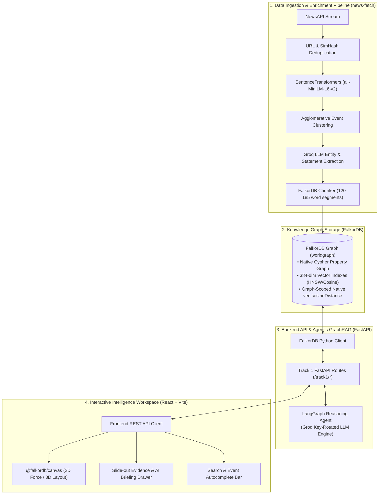
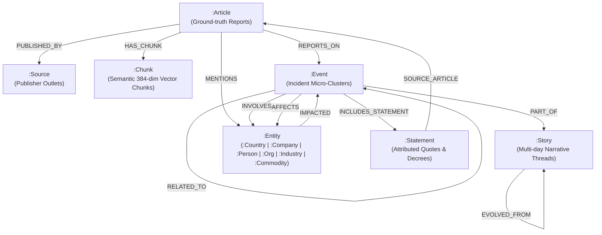

# WorldGraph — Global Event Intelligence Knowledge Graph

[](https://falkordb.com/)
[](https://fastapi.tiangolo.com/)
[](https://react.dev/)
[](https://langchain-ai.github.io/langgraph/)
[](LICENSE)

> **Graph Hacks: Building Next-Gen RAG (WeMakeDevs × FalkorDB)**  
> Track 1: Grounded News Intelligence & Deep Causal Analysis Engine

---

## 1. Overview & Key Capabilities

**WorldGraph** is an enterprise-grade, agentic intelligence platform that transforms raw, high-volume news streams into a multi-layered property graph in **FalkorDB**. By integrating native 384-dimensional dense vector embeddings with Cypher graph traversals, WorldGraph eliminates hallucinations in Retrieval-Augmented Generation (GraphRAG) and delivers fact-grounded causal explanations.

### Core Capabilities:
- **UC-01: Investigate Event (360° Incident Intelligence)**: Deep breakdown of any global event with multi-hop graph expansion, identifying key actors, causal drivers, and exact verified quotes backed by source reporting.
- **UC-02: Impact Radius (Shockwave & Blast Radius Analysis)**: Traverses 1-to-2 hops of `AFFECTS`, `CAUSED`, and `INVOLVES` relationships to calculate systemic shockwaves across industries, commodities, and geographic chokepoints.
- **UC-03: Connect the Dots (Causal Path Synthesis)**: Discovers the shortest evidence-backed causal path connecting any two global events or entities, producing an executive bridge narrative with confidence metrics for every step.
- **UC-04: Evidence Trail (Sub-Millisecond Ground Truth Inspection)**: Provides complete auditability for every claim down to raw sentence-level article text chunks and publisher citations via FalkorDB native vector similarity.

---

## 2. System Architecture

WorldGraph separates data processing into three modular tiers: an **event ingestion & clustering pipeline**, a **FastAPI backend with LangGraph reasoning agents**, and an **Apple-style glassmorphic React workspace**.



---

## 3. Graph Data Model

WorldGraph organizes news intelligence into a **multi-layer property graph** where articles, semantic text chunks, daily micro-events, macro narrative threads, and real-world entities are connected via typed, timestamped edges.



### 3.1 Node Types & Schema

| Label | Primary Key | Key Attributes | Role & Indexing |
| :--- | :--- | :--- | :--- |
| **`:Event`** | `event_id` | `title`, `summary`, `category`, `occurred_at`, `centroid` | Micro-incident cluster; scalar indexes on `event_id`, `category`, `occurred_at`; **384-dim vector index** on `centroid`. |
| **`:Story`** | `story_id` | `title`, `first_seen`, `last_seen`, `article_count` | Macro narrative thread spanning multiple weeks/months. |
| **`:Entity`** | `canonical_name` | `aliases`, multi-label (`:Country`, `:Company`, `:Person`, `:Organization`, `:Industry`, `:Commodity`) | Real-world entities; scalar indexes on `canonical_name` and sublabels. |
| **`:Article`** | `url` | `title`, `description`, `published_at`, `author`, `url_to_image` | Source article from journalism outlets; scalar index on `url` & `published_at`. |
| **`:Chunk`** | `chunk_id` | `text`, `word_count`, `chunk_index`, `embedding` | Semantic 120–185 word text segment; **384-dim native vector index** on `embedding`. |
| **`:Source`** | `source_id` | `name`, `reliability` | News outlet publisher profile (e.g. Reuters, Bloomberg). |
| **`:Statement`** | `statement_id` | `text`, `issued_at` | Verified quotes, claims, or official state declarations. |

---

### 3.2 Edge Types & The Trust Property Contract

All reasoning edges (`CAUSED`, `CONTRIBUTED_TO`, `AFFECTS`, `IMPACTED`, `RELATED_TO`) adhere strictly to the **Trust Property Contract**:

```text
Edge Properties Schema:
├── status:       "confirmed" 🟢 | "inferred" 🟡 | "related" ⚪
├── confidence:   Float (0.0 .. 1.0)
├── evidence_ids: List[String] (Article URLs proving the relationship)
├── rationale:    String (LLM causal explanation or human verification note)
├── agent:        String ("graph_agent_v1" | "rule_engine_v1" | "editor")
├── created_at:   ISO 8601 Timestamp
├── valid_from:   ISO 8601 Timestamp
└── valid_to:     ISO 8601 Timestamp or null
```

| Relationship | Start Node | End Node | Description |
| :--- | :--- | :--- | :--- |
| **`REPORTS_ON`** | `:Article` | `:Event` | Links article to the clustered event; stores `similarity` score to centroid. |
| **`HAS_CHUNK`** | `:Article` | `:Chunk` | Connects article to its constituent vector chunks for native FalkorDB search. |
| **`INVOLVES`** | `:Event` | `:Entity` | Describes actors, targets, and participants with their incident roles. |
| **`CAUSED`** | `:Event` | `:Event` | Direct causal link where Event A directly triggered Event B. |
| **`CONTRIBUTED_TO`**| `:Event` | `:Event` | Contributing factor or indirect causal pressure. |
| **`AFFECTS`** | `:Event` | `:Entity` | Downstream impact on an industry, commodity, company, or country. |
| **`PART_OF`** | `:Event` | `:Story` | Ties an event to an overarching narrative storyline. |
| **`PRECEDED`** | `:Event` | `:Event` | Directed chronological edge between successive events ($T_1 \to T_2$). |

---

### 3.3 FalkorDB Native Vector Search Syntax

FalkorDB indexes dense 384-dimensional embeddings on `:Chunk` and `:Event` nodes. Vector queries execute natively inside Cypher using `vec.cosineDistance`:

```cypher
// Graph-Scoped Vector Search: Scopes retrieval to chunks of articles reporting on a specific event
MATCH (e:Event {event_id: $event_id})<-[:REPORTS_ON]-(a:Article)-[:HAS_CHUNK]->(c:Chunk)
WHERE c.embedding IS NOT NULL
WITH a, c, (1.0 - vec.cosineDistance(c.embedding, vecf32($query_vector))) AS similarity
RETURN a.title, c.chunk_id, c.text, similarity
ORDER BY similarity DESC
LIMIT 5
```

---

## 4. Visual Palette & UI Canvas Specifications

WorldGraph integrates `@falkordb/canvas` to render GPU-accelerated interactive graph topologies:

```
Nodes Palette:
  ● Event       #3B82F6 (Blue)
  ● Story       #8B5CF6 (Purple)
  ● Country     #10B981 (Emerald)
  ● Company     #F59E0B (Amber)
  ● Industry    #D946EF (Fuchsia)
  ● Commodity   #EAB308 (Gold)
  ● Person      #06B6D4 (Cyan)
  ● Article     #6B7280 (Gray)

Edge Trust Styling:
  ── confirmed  #10B981 Solid line
  -- inferred   #F59E0B Dashed line
  ·· related    #9CA3AF Dotted line
```

---

## 5. Prerequisites

Before setting up the project, make sure you have:

- **Docker** (to run FalkorDB)
- **Python 3.10+** (Python 3.11+ recommended, with `uv` or `pip`)
- **Node.js 18+** & **pnpm** (or `npm`)
- **Groq API Key** (for fast LangGraph LLM inference; free tier available at [groq.com](https://groq.com))
- **NewsAPI Key** (optional, only required if running fresh daily ingestion from `news-fetch`)

---

## 6. Step-by-Step Setup Instructions

### Step 1: Start FalkorDB

Run the official FalkorDB Docker container:

```bash
docker run -p 6379:6379 -it --name falkordb -d falkordb/falkordb:latest
```

Verify that FalkorDB is running:
```bash
docker exec -it falkordb redis-cli ping
# Response: PONG
```

---

### Step 2: Configure & Launch the Backend

1. Navigate to the backend directory:
   ```bash
   cd backend
   ```

2. Create and activate a Python virtual environment:
   ```bash
   python3 -m venv .venv
   source .venv/bin/activate
   ```

3. Install backend dependencies (using `uv` or `pip`):
   ```bash
   pip install -e .
   # or with uv:
   # uv pip install -e .
   ```

4. Create your `.env` configuration file:
   ```bash
   cp .env.example .env
   ```

5. Edit `.env` with your settings:
   ```env
   # Comma-separated Groq API keys for automatic round-robin rotation
   GROQ_API_KEYS=gsk_your_groq_api_key_here

   # FalkorDB Connection Settings
   FALKORDB_HOST=localhost
   FALKORDB_PORT=6379
   FALKORDB_GRAPH=worldgraph
   ```

6. Start the FastAPI development server:
   ```bash
   uvicorn app.main:app --reload --port 8000
   ```

   The backend will be live at `http://localhost:8000`. You can inspect the Swagger documentation at `http://localhost:8000/docs`.

---

### Step 3: Configure & Launch the Frontend

1. Open a new terminal and navigate to the frontend directory:
   ```bash
   cd frontend
   ```

2. Install frontend dependencies:
   ```bash
   pnpm install
   # or: npm install
   ```

3. Launch the Vite development server:
   ```bash
   pnpm run dev
   # or: npm run dev
   ```

4. Open your browser and navigate to:
   ```
   http://localhost:5173
   ```

---

### Step 4 (Optional): Run the News Ingestion Pipeline

If you want to fetch and cluster fresh news articles into your FalkorDB instance:

1. Navigate to the pipeline directory:
   ```bash
   cd news-fetch
   ```

2. Install pipeline dependencies:
   ```bash
   pip install -r requirements.txt
   ```

3. Set up environment variables in `news-fetch/.env`:
   ```bash
   cp .env.example .env
   ```
   Provide your `NEWS_API_KEYS`, `GROQ_API_KEYS`, and `FALKORDB_HOST`.

4. Execute pipeline stages:
   ```bash
   # Run Phase 1: Ingestion, deduplication & clustering
   python run_phase1.py

   # Run Phase 2: Entity normalization & event enrichment
   python run_phase2.py

   # Run Phase 3: Temporal linking & causal reasoning edges
   python run_phase3.py

   # Ingest chunk text & generate native FalkorDB vector indexes
   python run_falkordb_chunks.py
   ```

---

## 7. REST API Reference

The FastAPI service exposes the following Track 1 endpoints:

| Endpoint | Method | Parameters | Description |
| :--- | :---: | :--- | :--- |
| `/track1/search` | `GET` | `q` (string), `limit` (int) | Autocomplete search across events, stories, and entities. |
| `/track1/investigate/{event_id}` | `GET` | `explain` (bool) | **UC-01**: Incident subgraph, key actors, catalysts, and AI briefing. |
| `/track1/impact/{event_id}` | `GET` | `explain` (bool) | **UC-02**: Blast radius subgraph, exposed sectors, and chokepoints. |
| `/track1/connect` | `GET` | `source_event_id`, `target_event_id`, `explain` (bool) | **UC-03**: Shortest causal path discovery & executive bridge synthesis. |
| `/track1/evidence/edge` | `GET` | `source_id`, `target_id`, `relationship` | **UC-04**: Edge provenance, confidence score, and supporting articles. |
| `/track1/evidence/node` | `GET` | `node_id` (path or query) | **UC-04**: Node inspection, connected articles, and corroborating sources. |
| `/health` | `GET` | *None* | Health check verifying FalkorDB connectivity. |

---

## 8. Interactive UI Workflow & Controls

- **Search & Quick Jump**: Type in the top bar to search for any entity (e.g. "Atlassian", "United States", "Crude Oil") or incident headline.
- **Node Left-Click**: Opens the slide-out intelligence drawer displaying ground-truth evidence, source articles, and publisher attribution.
- **Node Right-Click**: Opens an action menu:
  - **Investigate Event (360°)**: Focuses the canvas on the event's local incident neighborhood.
  - **Impact Radius**: Visualizes the downstream shockwave and exposed sectors.
  - **Set as Start Point (A)**: Sets the origin for causal path analysis.
  - **Connect to Here (B)**: Appears once Point A is chosen; triggers shortest path causal graph discovery and AI narrative synthesis.
- **AI Explain Switch**: Toggle on the canvas to generate deep, LLM-reasoned executive briefs with citation quotes and grounding scores.
- **Canvas View Modes**: Switch between 2D Force-Directed, Radial, Tree, and 3D Canvas layouts in real-time.

---

## 9. License

This project is licensed under the [MIT License](LICENSE).
