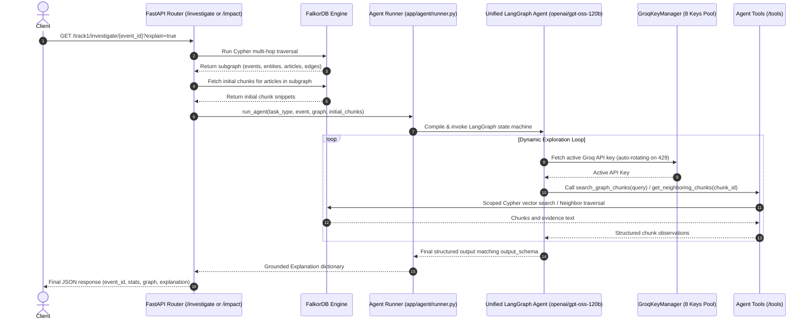

# Unified LangGraph Agent Architecture

**Component:** Multi-Task GraphRAG Reasoning Engine  
**Location:** `app/agent/`  
**Model:** `openai/gpt-oss-120b` (via Groq API with 8-Key Cooldown Rotation)  
**Framework:** LangGraph + FalkorDB Native Vector & Graph Traversal  

---

## 1. Overview & Core Philosophy

Instead of maintaining fragmented agent implementations across use cases (e.g. Investigation, Impact Radius, Story Evolution), the system uses a **Single Unified LangGraph Agent**.

The agent is entirely generic and dynamically parameterized by:
1. **`system_prompt`**: Injected from `app/agent/prompts/` (e.g. `investigate_prompt.py`, `impact_prompt.py`).
2. **`output_schema`**: Pydantic schema from `app/agent/schemas.py` enforcing structured JSON generation for the specific use case.
3. **Graph-Scoped Boundary Constraint**: Scoped to the articles and events discovered in the FalkorDB traversal.

---

## 2. Directory Structure

```text
app/
├── agent/
│   ├── __init__.py              # Agent exports
│   ├── graph.py                 # Core LangGraph state machine (1 unified agent)
│   ├── runner.py                # Agent invocation entry point (handles key rotation & dispatch)
│   ├── schemas.py               # Pydantic schemas (InvestigateExplanation, ImpactExplanation)
│   ├── tools/
│   │   ├── __init__.py          # Tool definitions & exports
│   │   ├── similarity_search.py # search_graph_chunks (strictly scoped to returned graph)
│   │   ├── neighboring_chunks.py# get_neighboring_chunks (using chunk_id)
│   │   └── embedding.py         # 384-d query vector encoder (all-MiniLM-L6-v2)
│   └── prompts/
│       ├── __init__.py          # Prompt exports
│       ├── investigate_prompt.py# Prompt for UC-01 (Multi-hop link analysis)
│       └── impact_prompt.py     # Prompt for UC-02 (Impact & blast radius)
├── services/
│   └── groq_key_manager.py      # Multi-key rate-limit rotation manager (8 keys)
├── router/
│   └── track1/
│       ├── __init__.py          # Main track1 APIRouter prefix="/track1"
│       ├── common.py            # Shared helpers (_clean_props, _get_color)
│       ├── events.py            # GET /track1/events
│       ├── investigate.py       # GET /track1/investigate/{event_id} (UC-01)
│       └── impact.py            # GET /track1/impact/{event_id} (UC-02)
```

---

## 3. Data Flow & Execution Sequence



---

## 4. Agent Tools Specification (`app/agent/tools/`)

### 4.1 `search_graph_chunks` (`similarity_search.py`)
- **Description:** Performs vector cosine similarity search for specific claims, numbers, or quotes, **strictly bounded** to the articles and events discovered in the returned graph.
- **Parameters:**
  - `query` (`string`, required): Natural language search query (e.g. *"TSMC export restriction timeline"*).
  - `limit` (`integer`, optional, default: `5`): Maximum chunks to return.
- **Underlying FalkorDB Cypher Query:**
  ```cypher
  MATCH (a:Article)-[:HAS_CHUNK]->(c:Chunk)
  WHERE a.url IN $scoped_article_urls
    AND c.embedding IS NOT NULL
  WITH a, c, (1.0 - vec.cosineDistance(c.embedding, vecf32($query_vector))) AS similarity
  RETURN a.title AS article_title,
         a.url AS article_url,
         c.chunk_id AS chunk_id,
         c.chunk_index AS chunk_index,
         c.text AS chunk_text,
         similarity
  ORDER BY similarity DESC
  LIMIT $limit
  ```
- **Scope Guarantee:** Chunks from articles outside `$scoped_article_urls` can never be retrieved or cited.

### 4.2 `get_neighboring_chunks` (`neighboring_chunks.py`)
- **Description:** Retrieves the preceding (`chunk_index - 1`) and following (`chunk_index + 1`) chunks of an article for deep context expansion around a key evidence piece.
- **Parameters:**
  - `chunk_id` (`string`, required): Unique deterministic chunk identifier (e.g. `https://reuters.com/article-123#c1`).
- **Why `chunk_id` is Sufficient:**
  - `chunk_id` is an indexed scalar on `:Chunk` in FalkorDB.
  - FalkorDB hops through the parent article `(a:Article)-[:HAS_CHUNK]->(curr:Chunk {chunk_id: $chunk_id})`.
  - The parent article connects to all sibling chunks of that report.
  - FalkorDB returns `curr.chunk_index - 1` and `curr.chunk_index + 1` in a single query.
- **Underlying FalkorDB Cypher Query:**
  ```cypher
  MATCH (a:Article)-[:HAS_CHUNK]->(curr:Chunk {chunk_id: $chunk_id})
  MATCH (a)-[:HAS_CHUNK]->(neighbor:Chunk)
  WHERE neighbor.chunk_index IN [curr.chunk_index - 1, curr.chunk_index + 1]
  RETURN neighbor.chunk_id AS chunk_id,
         neighbor.chunk_index AS chunk_index,
         neighbor.text AS chunk_text,
         a.title AS article_title,
         a.url AS article_url,
         CASE WHEN neighbor.chunk_index < curr.chunk_index THEN 'previous' ELSE 'next' END AS position
  ORDER BY neighbor.chunk_index ASC
  ```

### 4.3 `EmbeddingService` (`embedding.py`)
- Generates 384-dimensional dense vectors using `all-MiniLM-L6-v2` (`fastembed` or `sentence-transformers`) to convert the text query into `vecf32` vectors for FalkorDB similarity search.

---

## 5. Prompts & Schemas (`app/agent/prompts/` & `schemas.py`)

### 5.1 Investigation Task (UC-01)
- **Prompt:** `app/agent/prompts/investigate_prompt.py`
  - Guides the model to explain *what happened*, summarize preceding incidents, identify key drivers, list exposed entities, and cite exact chunks for facts.
- **Schema:** `InvestigateExplanation`
  ```python
  class CitedChunk(BaseModel):
      chunk_id: str
      article_title: str
      article_url: str
      chunk_index: int
      chunk_text: str
      similarity: Optional[float] = None

  class InvestigateExplanation(BaseModel):
      summary: str
      key_drivers: list[str]
      exposed_entities: list[str]
      grounded: bool = True
      cited_chunks: list[CitedChunk]
  ```

### 5.2 Impact Radius Task (UC-02)
- **Prompt:** `app/agent/prompts/impact_prompt.py`
  - Guides the model to trace the blast radius radiating outward from the incident, assessing critical chokepoints and vulnerable sectors/countries.
- **Schema:** `ImpactExplanation`
  ```python
  class ImpactExplanation(BaseModel):
      summary: str
      critical_chokepoints: list[str]
      most_exposed_industries: list[str]
      grounded: bool = True
      cited_chunks: list[CitedChunk]
  ```

---

## 6. Rate Limit Resilience (8-Key Groq Rotation)

All LLM calls in `app/agent/graph.py` are dispatched via `groq_key_manager.execute_with_retry()`:
- Maintains individual `available_at` timestamps for all 8 keys in `.env`.
- If Groq returns a `429 Rate Limit`, parses the cooldown (from `retry-after` header or error text), marks the key unavailable, and rotates immediately to the next available key.
- If all 8 keys are rate-limited, sleeps for `min(available_at) - current_time` until the earliest key recovers.
