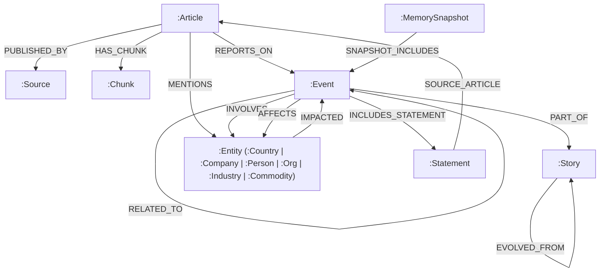

# FalkorDB Graph Schema Reference

**Project:** WorldGraph — AI Knowledge Graph for Global Event Intelligence  
**Hackathon:** Graph Hacks: Building Next-Gen RAG (WeMakeDevs × FalkorDB)  
**Database:** FalkorDB (Redis-based Property Graph with Native Vector Indexing)  

---

## 1. Schema Architecture & Mental Model

WorldGraph organizes news intelligence into a **multi-layer Property Graph**. Rather than storing unstructured article text in isolation, the schema models the real-world relationships between **publishers**, **reported incidents**, **macro narrative threads**, **real-world entities** impacted by global shocks, and **dense vector chunks** enabling sub-millisecond GraphRAG retrieval directly in Cypher.



---

## 2. Node Specifications

### 2.1 `:Source` (News Outlet / Publisher)
Represents the publisher or domain originating an article.
* **Label:** `:Source`
* **Properties:**
  | Property | Type | Description | Index |
  | :--- | :--- | :--- | :--- |
  | `source_id` | String | Unique slug identifier (e.g., `reuters`, `bbc-news`) | **Indexed** |
  | `name` | String | Display name of publisher (e.g., `Reuters`) | |
  | `reliability` | Float | Credibility score between `0.0` and `1.0` (default: `1.0`) | |

---

### 2.2 `:Article` (Individual Report)
Represents an atomic news report fetched from NewsAPI.
* **Label:** `:Article`
* **Properties:**
  | Property | Type | Description | Index |
  | :--- | :--- | :--- | :--- |
  | `url` | String | Canonical URL of the article (Unique ID) | **Indexed** |
  | `title` | String | Article headline | |
  | `description` | String | Short excerpt or snippet | |
  | `author` | String | Byline author or reporter | |
  | `published_at` | String | ISO 8601 publication timestamp (`YYYY-MM-DDTHH:MM:SSZ`) | **Indexed** |
  | `url_to_image` | String | Thumbnail image URL | |

---

### 2.3 `:Chunk` (Semantic Article Text Chunk)
Represents a cleaned, 120–185 word semantic paragraph segment of an article for native vector search without token truncation.
* **Label:** `:Chunk`
* **Properties:**
  | Property | Type | Description | Index |
  | :--- | :--- | :--- | :--- |
  | `chunk_id` | String | Unique deterministic slug (`{article_url}#c{chunk_index}`) | **Indexed** |
  | `chunk_index` | Integer | Chronological chunk position within article (`0, 1, 2...`) | |
  | `text` | String | Clean paragraph text for UI presentation & LLM prompt injection | |
  | `word_count` | Integer | Word count of the chunk (120–185 words) | |
  | `embedding` | `vecf32[384]` | 384-dimensional dense vector (`all-MiniLM-L6-v2`) with context headline prefix | **Vector Index** |

---

### 2.4 `:Event` (Daily Incident Micro-Cluster)
Represents a specific real-world event formed by clustering semantically similar articles on a given day.
* **Label:** `:Event`
* **Properties:**
  | Property | Type | Description | Index |
  | :--- | :--- | :--- | :--- |
  | `event_id` | String | Unique deterministic slug (e.g., `event_2026-09-15_cluster_03`) | **Indexed** |
  | `title` | String | Representative headline or title for the incident | |
  | `summary` | String | Synthesized overview of the incident | |
  | `category` | String | Topic category (e.g., `Conflict`, `Economy`, `Technology`) | **Indexed** |
  | `sentiment` | String | Sentiment tag (`positive`, `negative`, `neutral`) | |
  | `occurred_at` | String | Date string (`YYYY-MM-DD`) | **Indexed** |
  | `first_seen` | String | First article publication timestamp | |
  | `last_seen` | String | Latest article publication timestamp | |
  | `centroid` | `vecf32[384]` | 384-dimensional dense vector (`all-MiniLM-L6-v2`) | **Vector Index** |

---

### 2.5 `:Story` (Multi-Day Narrative Thread)
Represents a continuous narrative thread linking events across days (e.g., a multi-week diplomatic summit or geopolitical crisis).
* **Label:** `:Story`
* **Properties:**
  | Property | Type | Description | Index |
  | :--- | :--- | :--- | :--- |
  | `story_id` | String | Unique story identifier (e.g., `story_red_sea_shipping_2026`) | **Indexed** |
  | `title` | String | Narrative headline | |
  | `first_seen` | String | First date of an event in this story | |
  | `last_seen` | String | Most recent date of an event in this story | |
  | `article_count` | Integer | Total number of articles linked to this story | |

---

### 2.6 `:Entity` (Real-World Entities)
Entities are modeled with multi-labeling: every entity node has both `:Entity` and a specific subtype label (e.g., `:Entity:Country`).
* **Multi-Labels:** `:Entity:<Type>`
  * Supported types: `:Country`, `:Company`, `:Person`, `:Organization`, `:Industry`, `:Commodity`, `:Location`
* **Properties:**
  | Property | Type | Description | Index |
  | :--- | :--- | :--- | :--- |
  | `canonical_name` | String | Disambiguated canonical name (e.g., `United States`, `TSMC`, `Crude Oil`) | **Indexed** (on `:Entity` & each subtype) |
  | `aliases` | List[String] | Alternate names, acronyms, or tickers (e.g., `["USA", "America", "US"]`) | |

---

### 2.7 `:Statement` (Attributed Quotes & Official Declarations)
Represents verified claims, quotes, or official decrees cited within articles.
* **Label:** `:Statement`
* **Properties:**
  | Property | Type | Description | Index |
  | :--- | :--- | :--- | :--- |
  | `statement_id` | String | SHA-1 hash or UUID of the statement | **Indexed** |
  | `text` | String | Direct quotation or official declaration text | |
  | `issued_at` | String | Timestamp or publication date | |

---

### 2.8 `:MemorySnapshot` (Episodic Memory Snapshot)
Captures graph state at discrete intervals for temporal diffing ([UC-05](file:///home/yashwant/MyProject/GraphHacksHackathons/NewsFetch/UseCase.md#L174), [UC-06](file:///home/yashwant/MyProject/GraphHacksHackathons/NewsFetch/UseCase.md#L205)).
* **Label:** `:MemorySnapshot`
* **Properties:**
  | Property | Type | Description | Index |
  | :--- | :--- | :--- | :--- |
  | `snapshot_id` | String | Unique timestamped snapshot ID | **Indexed** |
  | `story_id` | String | Associated story identifier | |
  | `timestamp` | String | ISO 8601 time when snapshot was captured | |
  | `node_count` | Integer | Number of active nodes in graph at snapshot time | |
  | `edge_count` | Integer | Number of active edges in graph at snapshot time | |

---

## 3. Relationship (Edge) Specifications

### 3.1 Structural & Ingestion Edges

| Relationship | Start Node | End Node | Properties | Description |
| :--- | :--- | :--- | :--- | :--- |
| `HAS_CHUNK` | `:Article` | `:Chunk` | `index`: Integer | Connects an article to its constituent semantic text chunks with vector embeddings. |
| `PUBLISHED_BY` | `:Article` | `:Source` | *None* | Links an article to its source news outlet. |
| `REPORTS_ON` | `:Article` | `:Event` | `similarity`: Float | Connects an article to the daily incident cluster; records cosine similarity to event centroid. |
| `PART_OF` | `:Event` | `:Story` | *None* | Binds an incident event to a broader narrative story. |
| `PRECEDED` | `:Event` | `:Event` | `days_gap`: Integer | Directed chronological edge ($T_1 \to T_2$). |
| `FOLLOWED` | `:Event` | `:Event` | `days_gap`: Integer | Inverse chronological edge ($T_2 \to T_1$). |

---

### 3.2 Entity & Statement Edges

| Relationship | Start Node | End Node | Properties | Description |
| :--- | :--- | :--- | :--- | :--- |
| `INVOLVES` | `:Event` | `:Entity` | `role`: String (`actor`, `target`, `participant`) | Connects an incident to participating countries, companies, or people. |
| `MENTIONS` | `:Article` | `:Entity` | `count`: Integer, `salience`: Float | Tracks how frequently and prominently an article cites an entity. |
| `INCLUDES_STATEMENT` | `:Event` | `:Statement` | *None* | Associates official quotes/decrees to the event. |
| `SOURCE_ARTICLE` | `:Statement` | `:Article` | *None* | Traces the quote back to the originating article. |

---

### 3.3 Causal & Reasoning Edges (The Trust Property Contract)

All reasoning edges (`CAUSED`, `CONTRIBUTED_TO`, `AFFECTS`, `IMPACTED`, `RELATED_TO`) adhere strictly to the **Trust Property Contract**:

```text
Edge Properties:
├── status:       "confirmed" 🟢 | "inferred" 🟡 | "related" ⚪
├── confidence:   Float (0.0 .. 1.0)
├── evidence_ids: List[String] (Article URLs proving the claim)
├── rationale:    String (LLM causal explanation or editor note)
├── agent:        String ("graph_agent_v1" | "rule_engine_v1" | "editor")
├── created_at:   ISO 8601 Timestamp
├── valid_from:   ISO 8601 Timestamp
└── valid_to:     ISO 8601 Timestamp or null
```

| Relationship | Start Node | End Node | Description |
| :--- | :--- | :--- | :--- |
| `CAUSED` | `:Event` | `:Event` | Direct causal connection ($E_1$ directly triggered $E_2$). |
| `CONTRIBUTED_TO` | `:Event` | `:Event` | Contributing factor or indirect causal pressure. |
| `AFFECTS` | `:Event` | `:Entity` | Downstream impact of an incident onto an entity (e.g., Strike affects Shipping Industry). |
| `IMPACTED` | `:Entity` | `:Event` | Reverse impact link (e.g., Currency devaluation impacted Market Selloff). |
| `RELATED_TO` | `:Event` | `:Event` | Thematic or contextual co-occurrence without direct causality (e.g., shared countries). |

> [!IMPORTANT]
> **Human-in-the-Loop Immutability Rule:**
> If an edge has `agent = 'editor'`, automated AI re-runs **MUST NOT** overwrite `status`, `confidence`, `evidence_ids`, or `rationale`. Human curation has absolute precedence over AI inference.

---

### 3.4 Episodic Memory Edges

| Relationship | Start Node | End Node | Properties | Description |
| :--- | :--- | :--- | :--- | :--- |
| `SNAPSHOT_INCLUDES` | `:MemorySnapshot` | `:Event` | *None* | Captures the state of events during a historical snapshot. |
| `EVOLVED_FROM` | `:Story` | `:Story` | `confidence`: Float | Narrative branch or evolution tracking over long durations. |

---

## 4. FalkorDB Indexing & Native Vector Search

### 4.1 Property Indexes
FalkorDB uses scalar indexes to enable sub-millisecond queries:
```cypher
CREATE INDEX FOR (a:Article) ON (a.url)
CREATE INDEX FOR (a:Article) ON (a.published_at)
CREATE INDEX FOR (c:Chunk) ON (c.chunk_id)
CREATE INDEX FOR (s:Source) ON (s.source_id)
CREATE INDEX FOR (e:Event) ON (e.event_id)
CREATE INDEX FOR (e:Event) ON (e.occurred_at)
CREATE INDEX FOR (e:Event) ON (e.category)
CREATE INDEX FOR (st:Story) ON (st.story_id)
CREATE INDEX FOR (c:Country) ON (c.canonical_name)
CREATE INDEX FOR (c:Company) ON (c.canonical_name)
CREATE INDEX FOR (p:Person) ON (p.canonical_name)
CREATE INDEX FOR (o:Organization) ON (o.canonical_name)
CREATE INDEX FOR (i:Industry) ON (i.canonical_name)
CREATE INDEX FOR (cmd:Commodity) ON (cmd.canonical_name)
CREATE INDEX FOR (l:Location) ON (l.canonical_name)
CREATE INDEX FOR (ent:Entity) ON (ent.canonical_name)
CREATE INDEX FOR (st:Statement) ON (st.statement_id)
```

### 4.2 Native Vector Indexes (384-dimensional)
Centroid embeddings on `:Event` nodes and chunk embeddings on `:Chunk` nodes are indexed natively in FalkorDB:
```cypher
-- Event Centroid Vector Index
CREATE VECTOR INDEX FOR (e:Event) ON (e.centroid) 
OPTIONS {dimension: 384, similarityFunction: 'cosine'}

-- Article Chunk Vector Index
CREATE VECTOR INDEX FOR (c:Chunk) ON (c.embedding) 
OPTIONS {dimension: 384, similarityFunction: 'cosine'}
```

### 4.3 Native Vector Distance Syntax in FalkorDB
FalkorDB executes vector distance comparisons natively in Cypher using `vec.cosineDistance`:
```cypher
-- Graph-Scoped Vector Search: Target Event -> Articles -> Chunks
MATCH (e:Event {event_id: $event_id})<-[:REPORTS_ON]-(a:Article)-[:HAS_CHUNK]->(c:Chunk)
WHERE c.embedding IS NOT NULL
WITH a, c, (1.0 - vec.cosineDistance(c.embedding, vecf32($query_vector))) AS similarity
RETURN a.title, c.chunk_id, c.text, similarity
ORDER BY similarity DESC
LIMIT 5
```

---

## 5. UI Visualization Styling Contract (`@falkordb/canvas`)

The graph nodes and edges map directly into `@falkordb/canvas` formatting:

### Node Colors by Label:
| Node Label | Color Hex | Sample Visual Role |
| :--- | :--- | :--- |
| `:Event` | `#3B82F6` (Blue) | Core incident micro-clusters |
| `:Story` | `#8B5CF6` (Purple) | Macro developing narratives |
| `:Country` | `#10B981` (Emerald) | Sovereign states & geopolitical actors |
| `:Company` | `#F59E0B` (Amber) | Corporations & market actors |
| `:Industry` | `#EC4899` (Pink) | Sectors (Semiconductors, Aviation, Shipping) |
| `:Commodity` | `#EAB308` (Yellow) | Raw assets (Crude Oil, Gold, Wheat) |
| `:Person` | `#06B6D4` (Cyan) | Key leaders, diplomats, CEOs |
| `:Article` | `#6B7280` (Gray) | Ground-truth reporting evidence |
| `:Chunk` | `#64748B` (Slate) | Semantic text chunks with vector embeddings |

### Edge Colors by Trust Status:
| Edge Status | Color Hex | Dash Style | Meaning |
| :--- | :--- | :--- | :--- |
| `🟢 confirmed` | `#10B981` | Solid line | Backed by credible primary source or verified by editor |
| `🟡 inferred` | `#F59E0B` | Dashed line | AI-reasoned connection with rationale; pending review |
| `⚪ related` | `#9CA3AF` | Dotted line | Thematic co-occurrence without confirmed causal link |
