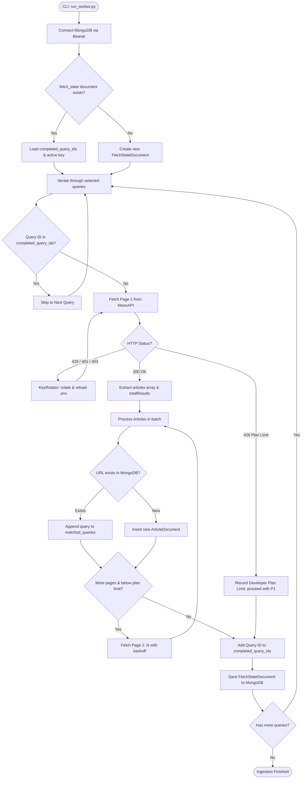

# Data Fetching Phase — NewsAPI to MongoDB

## 1. Overview & Objective

The **Data Fetching** phase is the foundational ingestion layer of the **WorldGraph / NewsFetch** pipeline. Its primary objective is to continuously ingest high-signal, real-world news articles from the [NewsAPI](https://newsapi.org/) `/v2/everything` endpoint across a designated 30-day historical window (`2026-09-08` to `2026-10-07`) and persist them into **MongoDB** (`news_pipeline` database, `articles` collection).

Subsequent graph-construction phases rely directly on the quality, integrity, and cleanliness of the articles stored during this phase.

```
┌─────────────────┐       HTTP Requests        ┌───────────────────────┐
│     NewsAPI     │ ─────────────────────────► │ NewsFetchWorker       │
│  /v2/everything │   (150 Curated Queries)    │ (Paging, KeyRotator)  │
└─────────────────┘                            └──────────┬────────────┘
                                                          │
                                     Deduplicate by URL   │ Upsert / Tag
                                                          ▼
                                               ┌───────────────────────┐
                                               │ MongoDB               │
                                               │ • articles            │
                                               │ • fetch_state         │
                                               └───────────────────────┘
```

---

## 2. The "Why": Architectural Motivations & Decisions

### A. Why Not Generic Queries or Wildcards (`*`)?
Running open-ended or broad keyword searches against general news APIs results in massive commercial noise, including:
* E-commerce affiliate links and product reviews (e.g., vacuum cleaners, kitchen gadgets).
* Retail promotions and shopping discounts.
* Celebrity gossip, lifestyle articles, and clickbait.

This pipeline is designed for **global intelligence, geopolitical events, market shocks, and systemic disruptions**. Ingesting noise degrades vector clustering (DBSCAN) and inflates storage and LLM token costs.

### B. Why 150 Curated Boolean Queries?
To maximize information density, [`selected_queries.py`](file:///home/yashwant/MyProject/GraphHacksHackathons/NewsFetch/app/services/selected_queries.py) was compiled from an initial pool in [`Queries.md`](file:///home/yashwant/MyProject/GraphHacksHackathons/NewsFetch/Queries.md). The queries cover:
* **Military Conflicts & Defense:** Airstrikes, artillery, missile defense, drone strikes, naval blockades.
* **Diplomacy & International Law:** Sanctions, treaties, UN Security Council resolutions, ICC warrants, diplomatic expulsions.
* **Macroeconomics & Finance:** Sovereign defaults, IMF bailouts, interest rate shocks, currency crashes, bank runs.
* **Cybersecurity & Critical Tech:** Ransomware on infrastructure, zero-day vulnerabilities, semiconductor export restrictions.
* **Natural Hazards & Catastrophes:** Major earthquakes, tsunamis, volcanic eruptions, catastrophic wildfires.
* **Public Health & Governance:** Epidemic outbreaks, state of emergency declarations, coups, mass civil protests.

### C. Why MongoDB with Beanie?
* **Flexible Document Structure:** Articles contain variable-length text bodies, descriptions, and dynamic nested source metadata.
* **Native Async I/O:** Powered by `Motor` and `Beanie`, fully compatible with FastAPI's asynchronous event loop.
* **Unique URL Indexing:** Guarantees database-enforced idempotency against race conditions.

---

## 3. Core Components

| Component | File Path | Primary Responsibility |
| :--- | :--- | :--- |
| **CLI Runner** | [`run_worker.py`](file:///home/yashwant/MyProject/GraphHacksHackathons/NewsFetch/run_worker.py) | Command-line interface with flags (`--status`, `--limit`, `--reset`, `--from-date`, `--to-date`). |
| **Worker Engine** | [`app/workers/fetch_worker.py`](file:///home/yashwant/MyProject/GraphHacksHackathons/NewsFetch/app/workers/fetch_worker.py) | Orchestrates the query loop, pagination, duplicate prevention, and graceful shutdown. |
| **Key Rotator** | [`app/services/key_rotator.py`](file:///home/yashwant/MyProject/GraphHacksHackathons/NewsFetch/app/services/key_rotator.py) | Manages an active pool of NewsAPI keys, handles HTTP 429/401/403, and reloads `.env` dynamically. |
| **Curated Queries** | [`app/services/selected_queries.py`](file:///home/yashwant/MyProject/GraphHacksHackathons/NewsFetch/app/services/selected_queries.py) | Array of 150 distinct boolean query objects with tracking IDs. |
| **Article Model** | [`app/models/documents/article.py`](file:///home/yashwant/MyProject/GraphHacksHackathons/NewsFetch/app/models/documents/article.py) | Beanie document for articles (`unique=True` on `url`). |
| **State Tracker** | [`app/models/documents/fetch_state.py`](file:///home/yashwant/MyProject/GraphHacksHackathons/NewsFetch/app/models/documents/fetch_state.py) | Checkpoint model tracking progress and execution metrics. |

---

## 4. End-to-End Execution Flow



---

## 5. In-Depth Technical Implementation

### 1. Resumability & Checkpointing
Because running 150 queries across historical dates can require hundreds of HTTP requests, operations must be interruptible and resilient to unexpected network drops or rate limits.

* **Tracking Document:** [`FetchStateDocument`](file:///home/yashwant/MyProject/GraphHacksHackathons/NewsFetch/app/models/documents/fetch_state.py) maintains:
  * `completed_query_ids: List[int]`
  * `current_query_index: int`
  * `active_key_index: int`
  * `total_api_calls`, `total_articles_fetched`, `total_articles_inserted`, `total_duplicates_skipped`
* **Restart Behavior:** If the process is killed or errors out, running `python run_worker.py` resumes seamlessly from the exact incomplete query index without repeating completed queries.
* **Resetting:** The `--reset` flag allows purging the state document to rerun the pipeline from scratch.

### 2. Multi-Key Rotation with Live `.env` Hot-Reloading
Free-tier NewsAPI keys are capped at 100 requests per day. To enable high-volume ingestion, [`KeyRotator`](file:///home/yashwant/MyProject/GraphHacksHackathons/NewsFetch/app/services/key_rotator.py) handles multi-key pooling:

* Keys can be configured comma-separated in `.env`:
  ```bash
  NEWS_API_KEYS=key1,key2,key3,key4
  ```
* **Failure Handling:**
  * **HTTP 429 (Rate Limit):** Rotates immediately to the next available key.
  * **HTTP 401 / 403 (Invalid / Unauthorized):** Flags the key as exhausted and advances to the next candidate.
* **Live `.env` Reloading:** Before rotating, `KeyRotator` checks `.env` on disk. If a developer pastes a fresh API key into `.env` while the ingestion worker is actively running, the new key is immediately detected and added to the pool without requiring a process restart.

### 3. Handling Pagination & Developer Tier Constraints (HTTP 426)
* NewsAPI limits page size to 100 articles.
* When results exceed 100, requests for page 2+ under the free Developer plan frequently trigger **HTTP 426 (Upgrade Required)**.
* **Graceful Degradation:** The worker explicitly inspects HTTP 426:
  ```python
  elif response.status_code == 426:
      logger.info("NewsAPI plan limitation (HTTP 426) on page ... Developer plan max results reached.")
      return {"status": "plan_limit", "articles": [], "totalResults": 0}
  ```
  Instead of failing the query, the worker preserves all articles ingested from Page 1 and marks the query complete.

### 4. Ingestion Deduplication & Tag Merging
A single breaking news story may match multiple distinct queries (e.g., both `"drone strike"` and `"military conflict"`).

1. **Junk Filtering:** Discards empty URLs, placeholder links (`https://removed.com`), and articles marked `[Removed]` by NewsAPI.
2. **Duplicate Detection:** Queries MongoDB:
   ```python
   existing = await ArticleDocument.find_one(ArticleDocument.url == url)
   ```
3. **Tag Merging:** If the article already exists:
   * It skips insertion.
   * If the current query string is not present in `existing.matched_queries`, it appends it:
     ```python
     existing.matched_queries.append(query_str)
     await existing.save()
     ```
   * Increments `total_duplicates_skipped`.
4. **Database-Level Protection:** `ArticleDocument.url` is annotated with `Indexed(str, unique=True)`. Even in concurrent insertion scenarios, MongoDB rejects duplicates with a `DuplicateKeyError`, which the worker catches safely.

### 5. Clean Shutdown Handling
The worker hooks OS signals `SIGINT` (Ctrl+C) and `SIGTERM`. When triggered:
1. `_shutdown_requested` is set to `True`.
2. The current page batch finishes inserting cleanly.
3. The checkpoint state is flushed to MongoDB.
4. The HTTP client connection pool closes gracefully.

---

## 6. How to Run and Verify

```bash
# 1. View current ingestion progress and statistics in MongoDB
python run_worker.py --status

# 2. Run a small test batch (first 5 queries only)
python run_worker.py --limit 5

# 3. Run all 150 queries across the default date range
python run_worker.py

# 4. Run ingestion across a custom historical window
python run_worker.py --from-date 2026-09-08 --to-date 2026-10-07

# 5. Clear checkpoint state and re-run from query 1
python run_worker.py --reset
```
