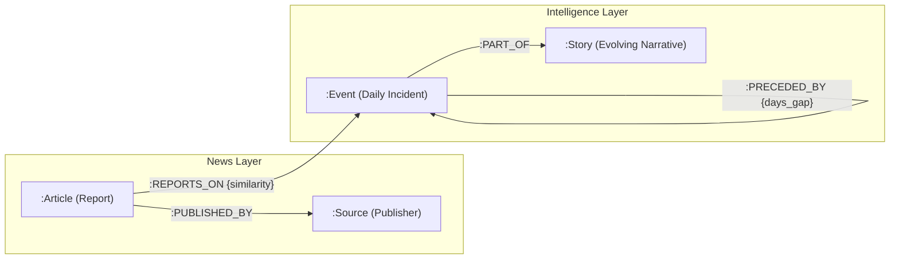

# Phase 1: Foundation (Articles → Events → Stories → FalkorDB)

## 1. Overview & Mental Model

While the **Data Fetching** phase gathered raw news documents into MongoDB, **Phase 1** constructs the foundational structural skeleton of the knowledge graph in **FalkorDB**.

It processes articles day-by-day and answers three fundamental questions:
1. *Which articles are reporting on the exact same real-world incident today?* → **`:Event` micro-clusters**
2. *Which news outlet published which report?* → **`:Article` & `:Source` relationships**
3. *How do today's events connect to developing narratives from previous days?* → **`:Story` threads & `:PRECEDED_BY` timelines**

```
MongoDB (ArticleDocument)
    │
    │ 1. Group articles by published_at (YYYY-MM-DD)
    ▼
[Daily Batch of Articles]
    │
    │ 2. Deduplicate: Normalized URL (SHA-1) + SimHash (Hamming distance ≤ 1)
    ▼
[Unique Articles]
    │
    │ 3. Embed: all-MiniLM-L6-v2 (384-dimensional dense vectors)
    ▼
[Dense Vectors]
    │
    │ 4. DBSCAN: eps=0.35, min_samples=2, metric=cosine
    ▼
[Daily Micro-Clusters (= Events)]
    │
    │ 5. Temporal Linker: Compare centroids against past 3 days (T-3 → T-1, sim ≥ 0.70)
    ▼
[Multi-Day Stories & Preceded Edges]
    │
    │ 6. Idempotent FalkorDB Writes (MERGE)
    ▼
FalkorDB Property Graph (:Article, :Source, :Event, :Story)
```

> [!NOTE]
> **What Phase 1 does NOT do:** It does not perform LLM entity extraction (e.g., Biden, Apple, Ukraine) or LLM causal discovery (e.g., "Sanction caused Inflation"). Those belong to **Phase 2 (Enrichment)** and **Phase 3 (Reasoning)**. Phase 1 provides the mathematical and graph structure.

---

## 2. The "Why": Architectural Motivations & Decisions

### A. Why Process Day-by-Day (Atomic Units)?
* **Real-world alignment:** News occurs chronologically. A developing crisis on October 5th builds upon what happened on October 4th.
* **Fault-tolerant resumption:** If processing 30 days fails on Day 15, the [`Phase1LedgerDocument`](file:///home/yashwant/MyProject/GraphHacksHackathons/NewsFetch/app/models/documents/phase1_ledger.py) records completed days. Re-running skips completed dates instantly.

### B. Why Two-Tier Deduplication (URL + SimHash)?
1. **Tier 1 (URL SHA-1):** Strips UTM tracking codes, anchor fragments (`#`), and URL query parameters to catch identical web pages.
2. **Tier 2 (SimHash Locality-Sensitive Hashing):** Syndicated news (e.g., AP, Reuters) is copied verbatim or with minor word swaps across hundreds of local media outlets with different URLs. SimHash calculates a 64-bit fingerprint of the text. If the Hamming bit distance is $\le 1$, it is identified as syndicated duplicate text and removed before embedding, saving compute.

### C. Why `all-MiniLM-L6-v2` (384-d Embeddings)?
* Runs locally on CPU/GPU without external API calls or rate limits.
* Generates compact 384-dimensional vectors with high semantic density.
* Cosine distance between embeddings accurately captures whether two articles discuss the same subject.

### D. Why DBSCAN Instead of K-Means?
* **Unknown Cluster Count:** With K-Means, you must pre-specify $k$ (the number of clusters). On any given day, there could be 15 events or 90 events—$k$ is impossible to know in advance.
* **Noise Rejection:** DBSCAN automatically classifies isolated articles that don't match any cluster as **noise** (`label = -1`), rather than forcing them into an unrelated cluster.
* **Parameters:** `eps = 0.35` (maximum cosine distance to be considered neighbors) and `min_samples = 2` (at least 2 articles required to form an event).

### E. Why Temporal Linking ($T-3 \dots T-1$, Threshold $0.70$)?
* Real-world events unfold over multiple days (e.g., Day 1: Hurricane warning → Day 2: Landfall → Day 3: Relief efforts).
* By comparing today's event vector centroid with centroids from the past 3 days:
  * If cosine similarity is $\ge 0.70$, today's event is linked to the existing **`:Story`**, and a `PRECEDED_BY` edge is drawn from the earlier event.
  * If similarity is $< 0.70$, a brand new **`:Story`** node is created.

### F. Why FalkorDB?
* FalkorDB is a Redis-based graph database that combines fast property graph Cypher queries with native vector indexing (`vecf32` cosine similarity).
* Allows sub-millisecond multi-hop queries across articles, publishers, events, and narrative timelines.

---

## 3. Core Components

| Component | File Path | Primary Responsibility |
| :--- | :--- | :--- |
| **CLI Runner** | [`run_phase1.py`](file:///home/yashwant/MyProject/GraphHacksHackathons/NewsFetch/run_phase1.py) | CLI commands (`--status`, `--run-all`, `--date`, `--limit-days`, `--force`, `--clear-graph`). |
| **Pipeline Orchestrator** | [`app/services/phase1_pipeline.py`](file:///home/yashwant/MyProject/GraphHacksHackathons/NewsFetch/app/services/phase1_pipeline.py) | Orchestrates daily processing, dedup, embedding, clustering, linking, and DB writes. |
| **Deduplication Service** | [`app/services/dedup.py`](file:///home/yashwant/MyProject/GraphHacksHackathons/NewsFetch/app/services/dedup.py) | URL stripping SHA-1 and 64-bit SimHash Hamming distance filtering. |
| **Embedding Service** | [`app/services/embeddings.py`](file:///home/yashwant/MyProject/GraphHacksHackathons/NewsFetch/app/services/embeddings.py) | SentenceTransformer (`all-MiniLM-L6-v2`) 384-dimensional dense vectors. |
| **Clustering Service** | [`app/services/clustering.py`](file:///home/yashwant/MyProject/GraphHacksHackathons/NewsFetch/app/services/clustering.py) | Scikit-learn DBSCAN with precomputed cosine distance and Silhouette metrics. |
| **Temporal Linker** | [`app/services/temporal_linker.py`](file:///home/yashwant/MyProject/GraphHacksHackathons/NewsFetch/app/services/temporal_linker.py) | Compares daily event centroids to T-3..T-1 candidates to link Stories and create `PRECEDED_BY` edges. |
| **FalkorDB Client** | [`app/services/falkordb_client.py`](file:///home/yashwant/MyProject/GraphHacksHackathons/NewsFetch/app/services/falkordb_client.py) | Idempotent Cypher `MERGE` queries and native `vecf32` vector indexing. |
| **Ledger Model** | [`app/models/documents/phase1_ledger.py`](file:///home/yashwant/MyProject/GraphHacksHackathons/NewsFetch/app/models/documents/phase1_ledger.py) | Beanie document tracking processing state per date (`PENDING`, `PROCESSING`, `COMPLETED`, `FAILED`). |

---

## 4. End-to-End Execution Flow

```mermaid
flowchart TD
    A[Start: Date YYYY-MM-DD] --> B[Check Ledger in MongoDB]
    B -- Completed & not --force --> Skip[Skip Date]
    B -- Pending / Failed --> C[Query MongoDB: articles for date]
    
    C --> D[DeduplicationService: URL + SimHash]
    D --> E[EmbeddingService: all-MiniLM-L6-v2]
    E --> F[ClusteringService: DBSCAN eps=0.35, min_samples=2]
    
    F --> G[Compute Event Centroids & Pick Representative Article]
    G --> H[Query FalkorDB for past 3 days candidate events]
    
    H --> I{Cosine similarity >= 0.70 to past event?}
    I -- Yes --> J[Link to existing Story & add PRECEDED_BY edge]
    I -- No --> K[Create new Story node]
    
    J --> L[FalkorDB Client: MERGE Articles, Sources, Events, Stories]
    K --> L
    L --> M[Update Ledger: status=COMPLETED]
    M --> Done([Date Finished])
```

---

## 5. Technical Deep Dive into Each Step

### Step 1: Ingestion & Ledger Check
[`phase1_pipeline.py`](file:///home/yashwant/MyProject/GraphHacksHackathons/NewsFetch/app/services/phase1_pipeline.py) queries MongoDB using a regex prefix on `published_at`:
```python
query_filter = {"published_at": {"$regex": f"^{date_str}"}}
docs = await ArticleDocument.find(query_filter).to_list()
```
The ledger [`Phase1LedgerDocument`](file:///home/yashwant/MyProject/GraphHacksHackathons/NewsFetch/app/models/documents/phase1_ledger.py) tracks counts for:
* `raw_articles_count`
* `deduped_articles_count`
* `clusters_count` (number of events)
* `noise_count`
* `stories_created` vs `stories_linked`

### Step 2: Two-Stage Deduplication
[`dedup.py`](file:///home/yashwant/MyProject/GraphHacksHackathons/NewsFetch/app/services/dedup.py) implements a **Two-Tier Deduplication Strategy** to handle both URL-level variations and syndicated news copies:

#### Tier 1: Normalized URL + SHA-1 Fingerprinting
* **Problem:** Identical web pages often carry tracking query strings (e.g., `?utm_source=twitter&ref=feed`), anchors (`#comments`), and trailing slash inconsistencies.
* **Process:**
  1. [`normalize_url()`](file:///home/yashwant/MyProject/GraphHacksHackathons/NewsFetch/app/services/dedup.py#L15-L21) parses the URL, retains only `scheme + netloc + path`, lowercases the string, and strips trailing slashes.
  2. Computes a 40-character hexadecimal `hashlib.sha1(normalized_url).hexdigest()`.
  3. Checks against an in-memory `seen_fingerprints` set in $O(1)$ constant time, pruning exact duplicate links.

#### Tier 2: SimHash Locality-Sensitive Hashing (Hamming Distance $\le 1$)
* **Problem:** Wire services (AP, Reuters, Bloomberg) distribute identical or near-identical articles that are republished across hundreds of regional newspapers under completely different domains (`apnews.com` vs `miamiherald.com` vs `bostonglobe.com`). URL checking fails completely. Standard cryptographic hashes (SHA-256/MD5) suffer from the avalanche effect (a single word tweak changes 50% of the hash bits).
* **Solution:** SimHash (Moses Charikar's Locality-Sensitive Hash) ensures:
  $$\text{High textual similarity} \iff \text{Tiny Hamming bit distance between fingerprints}$$

```
Raw Text (title + description + content)
    │
    ▼ 1. Clean & lowercases text
    │
    ▼ 2. Extract 4-character sliding shingles ("eart", "arth", "rthq"...)
    │
    ▼ 3. Frequency Weighting: count occurrences of each shingle (w)
    │
    ▼ 4. 64-bit hash of each shingle
    │
    ▼ 5. 64-element vector accumulator V[0..63]:
    │      For bit=1: V[i] += w
    │      For bit=0: V[i] -= w
    │
    ▼ 6. Threshold (V[i] > 0 -> 1, else 0) -> Final 64-bit Integer
```

* **The 64-Bit Vector Accumulator:**
  An array $V = [0, \dots, 0]$ of 64 integers accumulates bit weights across all 4-character shingles:

| Shingle | Weight ($w$) | Toy 4-bit Hash | Bit 0 | Bit 1 | Bit 2 | Bit 3 |
| :--- | :---: | :---: | :---: | :---: | :---: | :---: |
| `"eart"` | 2 | `1 0 1 1` | $+2$ | $-2$ | $+2$ | $+2$ |
| `"tsun"` | 3 | `1 1 0 1` | $+3$ | $+3$ | $-3$ | $+3$ |
| `"japa"` | 1 | `0 0 1 1` | $-1$ | $-1$ | $+1$ | $+1$ |
| **Sum ($V$)**| | | **$+4$** | **$0$** | **$0$** | **$+6$** |
| **Final Bits**| | | **1** | **0** | **0** | **1** |

* **Hamming Distance Comparison:**
  Two articles are compared in hardware using bitwise XOR and Brian Kernighan's bit-clearing loop:
  $$\text{distance}(A, B) = \text{popcount}(A \oplus B)$$
  * **Distance = 0:** Exactly identical text.
  * **Distance = 1:** Out of 64 bits, **63 bits match identically ($\ge 98.4\%$ similarity)**. This indicates syndicated wire content with minor editorial tweaks (e.g. adding *"officials said"* or changing a dateline). Dropped as duplicate.
  * **Distance $\ge 2$:** Preserved so DBSCAN can legitimately cluster related, distinct coverage into an `:Event`.

### Step 3: Vector Embeddings
[`embeddings.py`](file:///home/yashwant/MyProject/GraphHacksHackathons/NewsFetch/app/services/embeddings.py) maps deduplicated articles into continuous 384-dimensional dense vectors where geometric distance corresponds to semantic similarity:

#### 1. Text Selection (`Title + Description`)
* **Process:** [`article_to_text()`](file:///home/yashwant/MyProject/GraphHacksHackathons/NewsFetch/app/services/embeddings.py#L26-L29) combines `article.title` and `article.description`.
* **Rationale:**
  * **Inverted Pyramid of Journalism:** The lead paragraph and headline contain >95% of factual event signals (Who, What, Where, When).
  * **Noise Reduction:** Avoids lengthy commentary, historical side-notes, and truncated NewsAPI boilerplate (e.g. `[+1234 chars]`).
  * **Efficiency:** Minimizes token count and ensures all inputs fit cleanly within transformer context limits.

#### 2. The Model: `all-MiniLM-L6-v2`
* **Architecture:** 6-layer Sentence-BERT transformer with 384 hidden dimensions (22.7M parameters).
* **Speed & Cost:** Encodes 150–300 articles/sec on CPU (~80 MB RAM footprint), running locally without external LLM API costs or rate limits.
* **Semantic Tuning:** Pre-trained on >1 billion sentence pairs using contrastive loss, mapping articles with synonymous phrasing (e.g., *"Pentagon missile package"* vs *"US sends interceptors"*) close together in vector space.

#### 3. Mathematical Optimization: L2 Unit Normalization
Embeddings are encoded with `normalize_embeddings=True`:
$$\|\vec{v}\|_2 = \sqrt{\sum_{i=1}^{384} v_i^2} = 1.0$$
* **Cosine Distance Simplification:**
  Because all vectors lie on the surface of a unit hypersphere, cosine distance reduces to a simple dot product:
  $$\text{Cosine Similarity}(\vec{a}, \vec{b}) = \vec{a} \cdot \vec{b}$$
  $$\text{Cosine Distance}(\vec{a}, \vec{b}) = 1 - (\vec{a} \cdot \vec{b})$$
* **Matrix Acceleration:** Pairwise distances across hundreds of daily articles compute in milliseconds via a single BLAS matrix multiplication: $D = 1 - (E \times E^T)$.

#### 4. Batch Inference (`batch_size=64`)
Articles are batched into chunks of 64, saturating vectorized CPU SIMD/AVX instructions and avoiding per-item kernel overhead.

* **Output:** A 2D NumPy array of shape $(N, 384)$ with `float32` precision representing the daily article population.

### Step 4: DBSCAN Micro-Clustering
[`clustering.py`](file:///home/yashwant/MyProject/GraphHacksHackathons/NewsFetch/app/services/clustering.py) groups articles into real-world incident micro-clusters that define **`:Event`** nodes:

#### 1. Why DBSCAN Over Other Algorithms?
* **Failure of K-Means:** K-Means requires specifying cluster count $K$ upfront, which is impossible for daily global news (events fluctuate unpredictably). Furthermore, K-Means has no concept of noise and forcibly assigns isolated opinion blogs or bizarre outliers into unrelated clusters.
* **Failure of Hierarchical / Agglomerative:** High computational complexity ($O(N^3)$), poor scalability, and arbitrary tree-cutting dendrogram thresholds.
* **Failure of HDBSCAN:** Designed for variable-density macro clusters; tends to label small, legitimate 2-to-3 article breaking news stories as noise.
* **Advantage of DBSCAN:** Discovers an arbitrary number of clusters automatically, isolates one-off uncorroborated reports as noise (`label = -1`), and forms crisp micro-clusters down to pairs of articles.

#### 2. Parameter Rationale
* **`metric = "precomputed"` with `cosine_distances(embeddings)`:** Text vector magnitude does not reflect meaning; angular orientation does. Pairwise cosine distance measures semantic divergence directly.
* **`eps = 0.35` (Cosine Similarity $\ge 0.65$):**
  $$\text{Cosine Distance} = 1 - \text{Cosine Similarity} \implies \text{Distance} \le 0.35 \iff \text{Similarity} \ge 0.65$$
  * *Too loose (e.g., $\epsilon=0.50$):* Merges distinct events within the same topic (e.g., an earthquake in Japan and an earthquake in Chile would be erroneously joined).
  * *Too tight (e.g., $\epsilon=0.20$):* Fragments reports of the same event if news outlets use slightly different phrasing.
  * *Empirical Sweet Spot:* $\epsilon = 0.35$ cleanly clusters varying journalistic reports of the exact same event.
* **`min_samples = 2`:**
  In news intelligence, an event is considered corroborated if reported by **at least two independent news sources**. Articles without a matching partner are marked as noise (`-1`) and excluded from event creation.

#### 3. Cluster Quality: Silhouette Score
The service evaluates cluster cohesion on non-noise articles (`labels != -1`):
$$s(i) = \frac{b(i) - a(i)}{\max(a(i), b(i))}$$
Where:
* $a(i)$ = Mean intra-cluster distance (cohesion of articles reporting on the same event).
* $b(i)$ = Mean nearest-cluster distance (separation between distinct events).
* $s \approx +1$ confirms tightly clustered, well-isolated real-world events.

* **Output:**
  1. `clusters`: List of `EventCluster` objects sorted by article count descending.
  2. `noise_articles`: Uncorroborated single-source articles.
  3. `cluster_metrics`: Cluster counts, noise ratios, and Silhouette scores.

### Step 5: Event Synthesis & Centroid Calculation
Once DBSCAN produces raw clusters of articles, the pipeline synthesizes each cluster into a structured, production-ready **`:Event`** entity:

#### 1. Normalized Vector Centroid ($\vec{C}$)
To represent the entire event in 384-dimensional space, the pipeline computes the arithmetic mean across all article vectors in the cluster and re-normalizes it back to unit length ($L_2$ norm):
$$\vec{\mu} = \frac{1}{k} \sum_{i=1}^k \vec{v}_i \quad \implies \quad \vec{C} = \frac{\vec{\mu}}{\|\vec{\mu}\|_2} \quad (\|\vec{C}\|_2 = 1.0)$$
*Re-normalization ensures $\vec{C}$ remains on the unit hypersphere, allowing subsequent dot products in vector indexes and temporal comparisons to equal exact cosine similarities.*

#### 2. Per-Article Centroid Similarity (`articles_with_sim`)
The pipeline measures how central each article is to the event centroid via dot product:
$$\text{sim}_i = \vec{v}_i \cdot \vec{C}$$
*This score is stored on the graph edge `(:Article)-[:REPORTS_ON {similarity: sim}]->(:Event)` and determines visual edge thickness in graph visualizers.*

#### 3. Medoid Representative Article Selection
Rather than picking an article arbitrarily or concatenating titles, the pipeline selects the **medoid**—the article whose embedding is closest to the centroid:
$$\text{rep\_article} = \arg\max_{i} (\text{sim}_i)$$
* `event.title = rep_article.title`: Provides the most central, objective headline for the event.
* `event.summary = rep_article.description`: Supplies the event's summary.

#### 4. Temporal Bounds & Category Taxonomy
* **`first_seen`:** $\min_{i} (\text{art}_i.\text{published\_at})$
* **`last_seen`:** $\max_{i} (\text{art}_i.\text{published\_at})$
* **`category`:** Inferred from `matched_queries` of the representative article (e.g. `"Missile strike"`, `"Earthquake"`, `"IMF bailout"`).

#### 5. Deterministic ID Generation
$$\text{event\_id} = \text{evt\_\{YYYY-MM-DD\}\_\{cluster\_idx\}}$$
*(e.g., `evt_2026-09-08_0`). Ensures idempotent `MERGE` writes in FalkorDB without duplicate nodes upon re-runs.*

### Step 6: Temporal Linking Across Days
[`temporal_linker.py`](file:///home/yashwant/MyProject/GraphHacksHackathons/NewsFetch/app/services/temporal_linker.py):
* Queries FalkorDB for active events occurring within $T-3$ to $T-1$.
* Computes vector dot product between today's event centroid and candidate centroids.
* **Match found ($\ge 0.70$):**
  * Assigns the existing `story_id`.
  * Creates a `(:Event)-[:PRECEDED_BY {days_gap: N}]->(:Event)` relationship.
* **No match ($< 0.70$):**
  * Spawns a new story: `story_{YYYY-MM-DD}_{idx}`.

### Step 7: Writing to FalkorDB
[`falkordb_client.py`](file:///home/yashwant/MyProject/GraphHacksHackathons/NewsFetch/app/services/falkordb_client.py) performs idempotent Cypher writes:
* Vector centroid stored using FalkorDB's native vector syntax: `vecf32($centroid)`.
* Vector index enabled:
  ```cypher
  CREATE VECTOR INDEX FOR (e:Event) ON (e.centroid) 
  OPTIONS {dimension: 384, similarityFunction: 'cosine'}
  ```

---

## 6. FalkorDB Graph Schema (Beginner-Friendly Deep Dive)

### A. What is FalkorDB?
FalkorDB is an in-memory **Property Graph Database** built on Redis and GraphBLAS. Instead of rigid tables (SQL) or isolated JSON documents (MongoDB), data is stored as an interconnected web of:
* **Nodes (Nouns):** The distinct entities (e.g., an Article, a Source, an Event, a Story).
* **Edges (Verbs):** Directed relationships connecting nodes (e.g., `[:PUBLISHED_BY]`, `[:REPORTS_ON]`).
* **Properties (Attributes):** Key-value details stored directly on nodes or edges (e.g., `url`, `title`, `similarity`).
* **Native Vector Support (`vecf32`):** Graph nodes can store high-dimensional vectors directly, allowing vector similarity search and graph path traversal to run in a single Cypher query.

### B. Graph Topology



### C. The 4 Node Labels

| Node Label | Key Properties | Purpose & Real-World Meaning |
| :--- | :--- | :--- |
| **`:Article`** | `url` *(unique)*, `title`, `description`, `published_at`, `author`, `url_to_image` | Represents an individual news report. Acts as verifiable ground-truth evidence linking back to the original publisher. |
| **`:Source`** | `source_id` *(unique)*, `name`, `reliability` | The news publisher (e.g., Reuters, BBC, Al Jazeera). Enables analysis of outlet bias, reliability, and reporting volume. |
| **`:Event`** | `event_id` *(unique)*, `title`, `summary`, `category`, `occurred_at`, `centroid` (`vecf32`) | A verified real-world incident on a specific date. Groups dozens of articles covering the same incident into one entity with an AI vector centroid. |
| **`:Story`** | `story_id` *(unique)*, `title`, `first_seen`, `last_seen`, `article_count` | An evolving narrative spanning multiple days or weeks (e.g., a developing war, political trial, or natural disaster). |

### D. The 4 Edge Types (Relationships)

| Edge Type | Pattern | Meaning & Edge Properties |
| :--- | :--- | :--- |
| **`:PUBLISHED_BY`** | `(:Article) -> (:Source)` | Indicates which publisher published the article. |
| **`:REPORTS_ON`** | `(:Article) -> (:Event)` | Connects an article to its event cluster.<br>**Property `similarity`:** Cosine similarity ($0.0 \dots 1.0$) between the article and event centroid. Determines visual edge thickness. |
| **`:PART_OF`** | `(:Event) -> (:Story)` | Designates that a daily event is a chronological chapter within an overarching story narrative. |
| **`:PRECEDED_BY`** | `(:Event) -> (:Event)` | Connects an earlier event to a subsequent event in the same story.<br>**Property `days_gap`:** Elapsed days between the consecutive events. |

### E. Sample Cypher Queries

1. **Find all articles reporting on an event:**
   ```cypher
   MATCH (a:Article)-[:REPORTS_ON]->(e:Event {event_id: "evt_2026-09-08_0"})
   RETURN a.title, a.url
   ```
2. **Trace a story's chronological development:**
   ```cypher
   MATCH (st:Story {story_id: "story_2026-09-08_0"})<-[:PART_OF]-(e:Event)
   RETURN e.occurred_at, e.title
   ORDER BY e.occurred_at ASC
   ```
3. **Semantic Vector Search across events:**
   ```cypher
   CALL db.idx.vector.queryNodes("Event", "centroid", 5, vecf32($search_vec))
   YIELD node, score
   RETURN node.title, node.occurred_at, score
   ```

---

## 7. How to Run and Inspect Phase 1

### CLI Commands:
```bash
# 1. View progress across all dates in MongoDB and FalkorDB graph stats
python run_phase1.py --status

# 2. Process a single date
python run_phase1.py --date 2026-09-08

# 3. Process all dates in MongoDB chronologically
python run_phase1.py --run-all

# 4. Process first 3 dates for quick verification
python run_phase1.py --run-all --limit-days 3

# 5. Reset FalkorDB graph and re-run from scratch
python run_phase1.py --clear-graph --run-all
```

### Visual Explorer:
Once Phase 1 runs, start the FastAPI server:
```bash
uvicorn app.main:app --reload --port 8000
```
Open **`http://localhost:8000/phase1`** in your browser to view:
* **Interactive Vis-Network Graph:** Visualizes Story hubs (purple), Event nodes (blue), Articles (teal), and Sources (amber).
* **Story Evolution Timeline:** Click any story to see how events unfolded chronologically day-by-day.
* **Node Inspector Drawer:** Inspect article text, similarity percentages, and source URLs.
